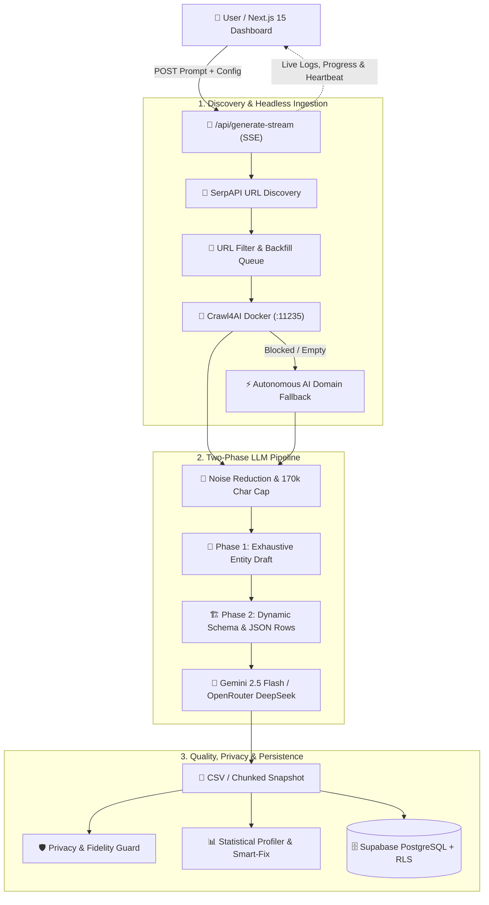

<div align="center">

# ⚡ Synthara AI

### Autonomous Web-Grounded Synthetic Data & Analytics Platform

*Turn natural language prompts into clean, schema-validated, privacy-audited datasets in real time.*

<p>
  <a href="https://github.com/marutigore/Synthara/actions/workflows/ci.yml">
    
  </a>
  <a href="https://github.com/marutigore/Synthara/blob/master/LICENSE">
    
  </a>
  
  
  
  
  
  
</p>

<p>
  <a href="#-key-features">Features</a> •
  <a href="#-system-architecture">Architecture</a> •
  <a href="#-api-ecosystem">API Ecosystem</a> •
  <a href="#-quick-start">Quick Start</a> •
  <a href="docs/ARCHITECTURE.md">Deep Dive Docs</a> •
  <a href="CONTRIBUTING.md">Contributing</a>
</p>

</div>

---

## 🎯 Overview

**Synthara** is an end-to-end AI data engineering platform that blends **automated web discovery**, **containerized headless crawling**, **two-phase multi-model LLM structuring**, and **real-time Server-Sent Events (SSE)** to transform natural-language prompts (e.g., *"Top EV charging networks in India with station counts and pricing"*) into production-ready CSV/JSON datasets.

Unlike naive LLM wrappers, Synthara is engineered for production resilience:
- **Self-healing scraping** via Dockerized **Crawl4AI** with autonomous domain-synthesis fallbacks when target sites block bots.
- **Two-phase Map-Reduce structuring** that drafts entities first and induces high-density schemas second, preventing context saturation and hallucinations.
- **Built-in Data Quality & Privacy Guard** featuring PII detection/masking, Shannon entropy fidelity scoring, statistical profiling, AI Smart-Fix, and interactive Nivo visualizations.

---

## ✨ Key Features

| Module | Capabilities |
| :--- | :--- |
| **🕷️ Autonomous Ingestion Engine** | Containerized Crawl4AI headless Chromium microservice (`:11235`), SerpAPI 3× URL over-fetching, smart backfill queues, `fit_markdown` extraction, and autonomous AI domain fallback on HTTP 403/500 blocks. |
| **🧠 Multi-Model AI Orchestrator** | Hybrid routing across **Google Gemini 2.5 Flash** (1M token window) and **OpenRouter (DeepSeek R1 / Nemotron)** with 170k-char corpus budgeting, dynamic schema induction, and JSON salvage recovery. |
| **📡 Real-Time SSE Streaming** | Native Web Streams (`text/event-stream`) delivering sub-second terminal telemetry, progress percentages, scraped previews, 30s keep-alive heartbeats, and in-flight request deduplication. |
| **🛡️ Privacy & Fidelity Guard** | Automated PII scanner (`email`, `phone`, `ssn`, `credit_card`, `ip_address`, `passport`) with `TAG`/`HASH`/`ASTERISKS` masking, Shannon entropy fidelity grading (`A+`–`D`), and GDPR/CCPA/HIPAA audits. |
| **📊 Analytics, Viz & Smart-Fix** | Statistical profiler (quartiles, outliers, correlations), AI Smart-Fix anomaly remediation, Nivo chart recommendations, OpenStreetMap geocoding, and one-click `.docx` executive report exports. |
| **🔐 Enterprise Auth & BYOK Vault** | Supabase PostgreSQL with Row-Level Security (RLS), dataset history/diff/merger, community Marketplace, and **AES-256 encrypted** HTTP-only cookies for user-supplied API keys. |

---

## 🏗️ System Architecture



> 📖 For detailed sequence diagrams, token budgeting strategy, and scaling architecture, read **[docs/ARCHITECTURE.md](docs/ARCHITECTURE.md)**.

---

## 🔌 API Ecosystem

Synthara integrates **7 external services** and exposes **37 internal Next.js API endpoints**:

### External Integrations
- **Google Gemini API (`gemini-2.5-flash`)** — Native high-speed, 1M-context extraction & structuring.
- **OpenRouter API (`DeepSeek R1` / `Nemotron`)** — Multi-model reasoning and fallback routing.
- **SerpAPI** — Live Google SERP discovery and URL ranking.
- **Crawl4AI Microservice** — Containerized Playwright/Chromium HTML-to-Markdown crawler.
- **Supabase** — PostgreSQL REST API, JWT Auth, RLS, and Storage buckets.
- **OpenStreetMap Nominatim** — Geospatial geocoding for map visualizations.
- **Hugging Face Transformers (`@xenova/transformers`)** — Local `all-MiniLM-L6-v2` embeddings for RAG chunking.

### Highlighted Internal Endpoints

| Endpoint | Method | Description |
| :--- | :---: | :--- |
| `/api/generate-stream` | `POST` / `GET` | Real-time SSE pipeline streaming scraping, drafting, and final CSV dataset |
| `/api/dataset/privacy-fidelity` | `POST` | Scans & masks PII, calculates Shannon entropy fidelity score & compliance audit |
| `/api/analyze-dataset` | `POST` | Computes column statistics, correlations, outliers, and AI deep insights |
| `/api/analysis/smart-fix` | `POST` | AI-driven cleaning and remediation for missing/malformed cells |
| `/api/dataviz/suggest-charts` | `POST` | Recommends optimal Nivo chart configurations for any dataset |
| `/api/export-docx` | `POST` | Exports formatted Microsoft Word (`.docx`) analytical reports |
| `/api/keys` | `GET` / `POST` | Manages AES-256 encrypted BYOK credentials in HTTP-only cookies |
| `/api/mock-api` | `GET` / `POST` | Exposes generated datasets as instant REST mock endpoints |

---

## 🚀 Quick Start

### Prerequisites
- **Node.js 20+** and **npm 9+**
- **Docker Desktop** (for the Crawl4AI microservice)
- A free **[Supabase](https://supabase.com)** project
- API keys for **Google Gemini** (or **OpenRouter**) and **SerpAPI**

### 1. Clone & Install
```bash
git clone https://github.com/marutigore/Synthara.git
cd Synthara
npm install
```

### 2. Configure Environment Variables
Copy `env.example` to `.env.local` and populate your keys:
```bash
# Supabase
NEXT_PUBLIC_SUPABASE_URL=https://your-project.supabase.co
NEXT_PUBLIC_SUPABASE_ANON_KEY=your-anon-key
SUPABASE_SERVICE_ROLE_KEY=your-service-role-key

# AI Providers & Search
GOOGLE_GEMINI_API_KEY=your-gemini-key
OPENROUTER_API_KEY=your-openrouter-key
OPENROUTER_MODEL=tngtech/deepseek-r1t2-chimera:free
SERPAPI_KEY=your-serpapi-key

# Crawl4AI Microservice
CRAWL4AI_SERVICE_URL=http://localhost:11235
NEXT_PUBLIC_APP_URL=http://localhost:3000
```

### 3. Initialize Supabase Schema
Run the SQL statements in [`supabase-complete-schema.sql`](supabase-complete-schema.sql) inside your Supabase SQL Editor (creates tables, indexes, storage bucket, and Row-Level Security policies).

### 4. Launch Services
```bash
# Start Crawl4AI headless browser container
docker compose up -d crawl4ai

# Start the Next.js development server
npm run dev
```

Open **[http://localhost:3000](http://localhost:3000)** to launch the Synthara dashboard.

---

## 🧰 Tech Stack

<p align="left">
  
  
  
  
  
  
  
  
</p>

---

## 📂 Project Structure

```text
Synthara/
├── .github/                  # GitHub Actions CI workflow, Issue & PR templates
├── docs/                     # System architecture & sequence diagrams
├── scripts/                  # DB setup, smoke tests & AI integration validators
├── server/                   # Python Crawl4AI & trainer microservices
├── src/
│   ├── ai/                   # Two-phase SimpleAI engine, flows & RAG chunker
│   ├── app/                  # Next.js App Router pages & 37 API endpoints
│   ├── components/           # Dashboard, terminal logger, dataviz & UI primitives
│   ├── lib/                  # Supabase clients, AES-256 encryption & job store
│   └── services/             # Crawl4AI, SerpAPI, Profiler, Privacy Guard, DOCX export
├── supabase/                 # RLS migration files
├── docker-compose.yml        # Multi-container orchestration (Next.js + Crawl4AI)
└── supabase-complete-schema.sql
```

---

## 🛠️ Developer Scripts

| Command | Description |
| :--- | :--- |
| `npm run dev` | Start Next.js dev server with hot reload |
| `npm run typecheck` | Run strict TypeScript validation (`tsc --noEmit`) |
| `npm run lint` | Run ESLint code quality checks |
| `npm run build` | Create optimized production build |
| `npm run setup:db` | Initialize Supabase schema and buckets locally |

---

## 🤝 Contributing & License

Contributions are welcome! Please read **[CONTRIBUTING.md](CONTRIBUTING.md)** for branch guidelines and commit conventions.

Distributed under the **MIT License**. See **[LICENSE](LICENSE)** for details.

---

<div align="center">
  Built with ⚡ by <strong>Maruti Gore</strong>
</div>
