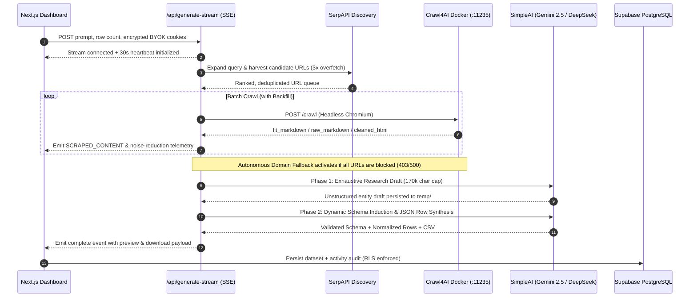

# Synthara System Architecture

This document outlines the internal architecture, dataflow, and engineering trade-offs behind **Synthara AI**.

---

## 1. End-to-End Pipeline Sequence

---

## 2. Core Engineering Pillars

### Pillar 1: Autonomous Ingestion & Resilient Scraping
- **Microservice Isolation**: Headless Chromium rendering runs inside an isolated Docker container (`unclecode/crawl4ai`) on port `11235` with strict CPU/RAM ceilings (`1.5 CPU / 2GB RAM`), preventing Node.js memory exhaustion.
- **Multi-Format Extraction**: Supports Crawl4AI 0.5.x markdown objects (`fit_markdown`, `raw_markdown`, `markdown_with_citations`) with cascading fallbacks to `fit_html`, `cleaned_html`, raw HTML, and page metadata.
- **Autonomous Self-Healing Fallback**: When target sites return anti-bot blocks (`HTTP 403`), timeouts, or empty DOMs, the orchestrator synthesizes domain-grounded seed knowledge instead of aborting the pipeline.

### Pillar 2: Two-Phase Multi-Model LLM Pipeline
- **Hybrid Provider Abstraction (`src/ai/simple-ai.ts`)**: Routes natively to **Google Gemini 2.5 Flash** (1M token context window) or **OpenRouter (DeepSeek R1 / Nemotron)** based on configuration and BYOK overrides.
- **Token Budgeting**: Enforces a `170,000`-character corpus ceiling (~42.5k tokens) after regex boilerplate stripping and deduplication to avoid "lost-in-the-middle" degradation.
- **Two-Stage Structuring**:
  1. **Phase 1 (Exhaustive Drafting)**: Extracts all candidate entities from the scraped corpus without schema rigidity.
  2. **Phase 2 (Dynamic Schema Induction)**: Induces 3–7 high-coverage columns and serializes unique rows into strict JSON + RFC 4180 CSV.

### Pillar 3: Event-Driven Real-Time Streaming (SSE)
- **Native Web Streams**: Uses `ReadableStream` with `text/event-stream` rather than full-duplex WebSockets to remain compatible with reverse proxies, serverless gateways, and HTTP/2 multiplexing.
- **Reliability Primitives**:
  - **Request Deduplication**: Prevents duplicate billing/token consumption for identical concurrent queries (`HTTP 429`).
  - **Keep-Alive Heartbeats**: Emits 30-second heartbeat frames to prevent idle proxy timeouts during 30–60s synthesis jobs.
  - **Graceful Abort Cleanup**: Hooks into `request.signal` to close streams and clear intervals immediately upon client disconnect.

### Pillar 4: Privacy, Data Quality & Security
- **Privacy & Fidelity Assurance (`/api/dataset/privacy-fidelity`)**: Scans generated rows for PII patterns (emails, phone numbers, SSNs, credit cards, IPs, passports), supports configurable masking (`TAG`, `HASH`, `ASTERISKS`), and computes Shannon entropy fidelity scores alongside GDPR/CCPA/HIPAA readiness audits.
- **Statistical Profiler & Smart-Fix**: Computes null percentages, quartiles, outliers, and correlation matrices, paired with AI remediation.
- **Zero-Plaintext BYOK Vault**: User-supplied Gemini/SerpAPI keys are encrypted with **AES-256** inside HTTP-only cookies and decrypted strictly in ephemeral request memory.
- **Tenant Isolation**: Supabase PostgreSQL enforces strict Row-Level Security (RLS) policies on `generated_datasets`, `user_activities`, `user_profiles`, and `file_storage`.
